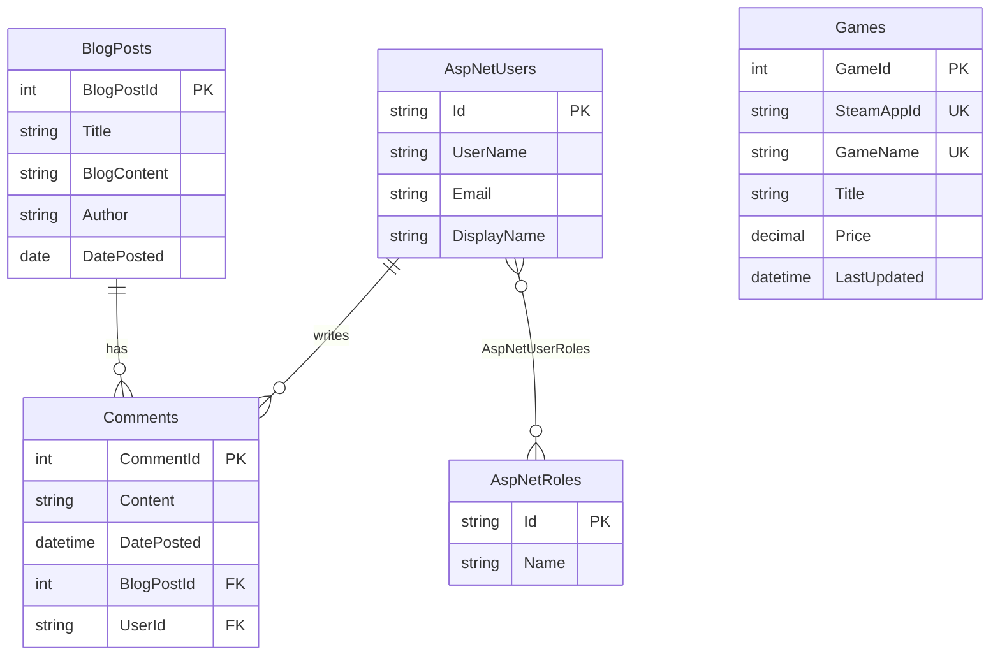

# Database Setup and Schema

The site uses **Entity Framework Core 10** with **SQL Server LocalDB**. The database is built entirely from code
(migrations), so nobody ever has to create tables by hand.

## 1. Set up the database on your computer

Do these steps once on each computer.

1. **Open the solution** in Visual Studio and let NuGet restore the packages (Build > Rebuild Solution).
2. **Add the connection string to User Secrets** (it is *not* stored in the repo):
   - Right-click the **DCSProject** project > **Manage User Secrets**.
   - Paste this into the `secrets.json` file that opens, then save:

   ```json
   {
     "ConnectionStrings": {
       "DefaultConnection": "Server=(localdb)\\MSSQLLocalDB;Database=DCSProject;Trusted_Connection=True;TrustServerCertificate=True"
     }
   }
   ```

   Command line alternative (run from the folder that contains `DCSProject.csproj`):

   ```
   dotnet user-secrets set "ConnectionStrings:DefaultConnection" "Server=(localdb)\MSSQLLocalDB;Database=DCSProject;Trusted_Connection=True;TrustServerCertificate=True"
   ```
3. **Create the database from the migrations.** Open **Tools > NuGet Package Manager > Package Manager Console**,
   make sure *Default project* is `DCSProject`, and run:

   ```
   Update-Database
   ```
4. **Check it worked:** View > SQL Server Object Explorer > (localdb)\MSSQLLocalDB > Databases > DCSProject > Tables.
   You should see the tables listed in section 2.

> `Add-Migration` is only run when someone **changes the models**. If you just pulled the latest code, you only need `Update-Database`.

### Why User Secrets?
`appsettings.json` is committed to GitHub, so passwords and server names do not belong in it. User Secrets are stored in
your Windows profile (`%APPDATA%\Microsoft\UserSecrets\`), outside the repo, so they can never be committed.
For a real hosted server, set the same value as an environment variable named `ConnectionStrings__DefaultConnection`.

## 2. Schema

| Table | Purpose | Created from |
|---|---|---|
| `Games` | Game info pulled from the Steam API, stored as a backup | `GameInfo` |
| `BlogPosts` | Blog posts | `BlogPost` |
| `Comments` | Comments on blog posts, one row per comment | `Comment` |
| `AspNetUsers` | Site users (login, email, password hash, display name) | `ApplicationUser` |
| `AspNetRoles` | Roles. `Admin` and `User` are added automatically by the migration | Identity |
| `AspNetUserRoles` | Links a user to their role(s) | Identity |
| `AspNetUserClaims`, `AspNetUserLogins`, `AspNetUserTokens`, `AspNetRoleClaims` | Extra Identity tables (unused for now) | Identity |



### Relationships and rules
- A **blog post** has many **comments**. Deleting a post deletes its comments.
- A **user** has many **comments**. Deleting a user deletes their comments.
- `Games.GameName` and `Games.SteamAppId` must each be unique.
- `Games.SystemRequirements` (a list of text) is stored in one JSON column.
- `Games.LastUpdated` is in UTC and tells the site when the Steam data was last refreshed.
- `Comments.DatePosted` is in UTC.

## 3. Changing the models later

1. Edit the model class.
2. Package Manager Console: `Add-Migration DescribeTheChange`
3. Package Manager Console: `Update-Database`
4. Commit the new files in the `Migrations` folder together with the model change.

If two people create a migration at the same time, the second person should pull first, delete their migration
(`Remove-Migration`), and create it again so the migrations stay in one straight line.

## 4. Starting over (local only)

If your local database gets into a bad state:

```
Drop-Database
Update-Database
```

## 5. Troubleshooting

| Problem | Fix |
|---|---|
| `Connection string 'DefaultConnection' was not found` | Step 2 above was skipped. Add the User Secret. |
| `CS0234 ... Microsoft.EntityFrameworkCore` | Packages not restored. Rebuild the solution or reopen it. |
| `Add-Migration` is not recognized | `Microsoft.EntityFrameworkCore.Tools` is missing or the Package Manager Console is on the wrong default project. |
| `Cannot open database` | LocalDB is not installed. Add it with the Visual Studio Installer > Individual components > "SQL Server Express LocalDB". |
